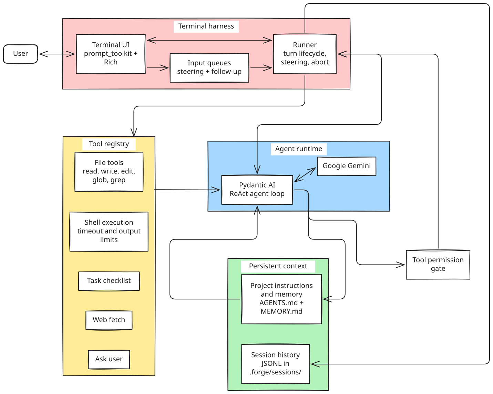

# Forge

**A terminal-based AI coding agent built from scratch in Python.**

Forge is an interactive coding agent that uses a ReAct (Reasoning + Acting) loop to interpret user instructions, choose tools, and work with a codebase. Powered by Google's Gemini models and Pydantic AI, it provides a terminal interface for reading and editing files, executing shell commands, fetching web content, and managing multi-step tasks.

Forge goes beyond a basic LLM wrapper by combining tool orchestration with explicit user approval, project-level context, persistent session history, and interactive execution controls.

## Key Features

- **ReAct agent loop:** Iteratively reasons about a task, invokes tools, and uses their results to decide what to do next.
- **Interactive terminal UI:** Uses `prompt_toolkit` and `Rich` for terminal interaction, streaming output, and execution controls.
- **Human-in-the-loop tool permissions:** Prompts for approval before executing tool calls.
- **Codebase tools:** Read, search, create, and edit files; execute shell commands; and fetch web content.
- **Project-aware context:** Loads `AGENTS.md` and `MEMORY.md` from the working directory and its parent directories.
- **Persistent project memory:** Appends a concise session summary to `MEMORY.md` when the application exits.
- **Session history and resumption:** Saves conversation records as JSONL and supports resuming previous sessions.
- **Task checklist:** Provides a tool for organizing multi-step work.
- **Testable agent behavior:** Uses Pydantic AI's `TestModel` and `FunctionModel` to test agent behavior without live model requests.
- **Developer workflow:** Includes formatting, linting, automated tests, and CI commands.

## Architecture

The current implementation separates the terminal interface, turn lifecycle, agent loop, permission gate, tools, and persistent state.

<p align="center">
  
</p>


### Execution flow

1. The user submits a task through the terminal interface.
2. Forge provides the agent with the task and available project context.
3. The model either responds directly or requests a tool call.
4. Forge asks the user to approve or deny the requested operation.
5. If approved, the tool executes and returns its result to the agent.
6. The agent uses the result to continue, call another tool, or produce a final response.
7. Forge persists session records and appends a short summary to project memory when the application exits.

The model proposes actions, but the application controls tool execution. This provides a visible approval boundary; it does **not**, by itself, sandbox commands or guarantee filesystem isolation.

## Technology Stack

| Component | Technology | Purpose |
|---|---|---|
| Language | Python 3.12 | Application and agent logic |
| Agent framework | Pydantic AI | Agent execution and tool orchestration |
| Language model | Google Gemini | Reasoning and tool selection |
| Terminal interface | `prompt_toolkit` | Interactive input and execution controls |
| Terminal rendering | `Rich` | Formatted terminal output |
| Configuration | `pydantic-settings` | Environment-based configuration |
| Package management | `uv` | Dependency management and project execution |
| Observability | Logfire / Opik | Tracing turns, LLM calls, and tool execution |
| Testing | `pytest` | Unit and integration testing |
| Linting and formatting | Ruff | Code-quality checks and formatting |
| Automation | Make | Development and CI commands |

## Available Tools

Tool calls are subject to the application's permission flow.

| Tool | Capability |
|---|---|
| `read` | Read file contents |
| `glob` | Find files matching patterns |
| `grep` | Search file contents |
| `write` | Create or overwrite files |
| `edit` | Modify existing files |
| `bash` | Execute shell commands |
| `todo_write` | Maintain a task checklist |
| `web_fetch` | Fetch web content and convert HTML to Markdown |
| `ask_user` | Request additional information from the user |

## Interactive Controls

| Action | Key |
|---|---|
| Send a message | `Enter` |
| Steer a running task | `Enter` while the agent is working |
| Queue a follow-up | `Alt+Enter` while the agent is working |
| Abort the current task | `Esc` |
| Approve or deny a tool call | `y` / `n` at the prompt |
| Exit | `Ctrl+D` or `/quit` |

## Memory and Session History

Forge keeps project context separate from session transcripts.

### Project context

- Reads `AGENTS.md` for project-specific instructions.
- Reads `MEMORY.md` for accumulated context.
- Searches the working directory and its parent directories for these files.
- Appends a concise summary to `MEMORY.md` when the application exits.

### Session history

- Stores session transcripts as JSONL files under `.forge/sessions/`.
- Supports resuming the most recent session or a specific session.

Project memory provides concise context for later sessions, while session history preserves the conversation record.

## Getting Started

### Prerequisites

- Python 3.12
- [`uv`](https://docs.astral.sh/uv/)
- A Gemini API key from [Google AI Studio](https://aistudio.google.com/apikey)

### 1. Clone the repository

Replace `YOUR_USERNAME` with your GitHub username and `forge` with the repository name if different.

```bash
git clone https://github.com/YOUR_USERNAME/forge.git
cd forge
```

If you use SSH for GitHub, you can use the SSH clone URL instead.

### 2. Install dependencies

```bash
make install
```

Alternatively, install dependencies directly:

```bash
uv sync
```

### 3. Configure environment variables

Create a local environment file:

```bash
cp .env.example .env
```

Set your API key in `.env`:

```dotenv
GEMINI_API_KEY=your-gemini-api-key
# Optional if the application defines a default:
GEMINI_MODEL=gemini-2.5-flash
```

Check `.env.example` and the application configuration for the exact supported variable names and defaults. Keep `.env` out of version control.

> **Windows note:** `cp` is available in Git Bash and many Unix-like shells. In PowerShell, use `Copy-Item .env.example .env`.

### 4. Run Forge

```bash
uv run forge
```

Forge starts an interactive terminal session. Enter a task and review each tool approval prompt.

### 5. Resume a session

Resume the most recent session:

```bash
uv run forge --resume
```

Resume a specific session:

```bash
uv run forge --resume <session-id>
```

Use the session identifier or filename format supported by your current implementation.

### 6. Install the CLI globally (optional)

To invoke `forge` directly from your terminal:

```bash
make install-cli
```

This uses `uv tool` to install the project in editable mode. If the command is not found, run:

```bash
uv tool update-shell
```

Restart your terminal if needed. To uninstall the CLI, run `make uninstall-cli` if that target exists in your Makefile.

## Testing and Code Quality

The test suite uses Pydantic AI's `TestModel` and `FunctionModel` where appropriate, so agent behavior can be tested without live model calls.

Run these commands from the repository root:

| Command | Purpose |
|---|---|
| `make test` | Run the full test suite |
| `make unit-tests` | Run unit tests |
| `make lint-check` | Run Ruff lint checks |
| `make format-check` | Check code formatting |
| `make pre-commit` | Run formatting, linting, and unit tests |
| `make ci` | Run the CI validation workflow |
| `make help` | List available Make targets |

Confirm the available targets against the current `Makefile` if these commands have changed.

## Engineering Decisions

### Explicit tool approval

The model can request an operation, but Forge controls whether it runs. This makes tool use visible and gives the user an opportunity to deny a requested action.

### Separation of orchestration and execution

The agent decides which tools to request; dedicated tool implementations perform the operations. This separation improves modularity and makes tool behavior easier to test.

### Persistent context

Project instructions, long-lived memory, and session history have different purposes. Keeping them separate supports continuity without relying solely on a large transcript.

### Testability without live inference

Pydantic AI's testing facilities allow important agent flows to be exercised without depending on API availability, network access, or inference costs.

### Interactive execution control

Steering, queued follow-ups, and cancellation give users more control than a simple request-response interface.

## Observability (Opik)

Forge integrates with [Opik](https://www.comet.com/site/products/opik/) for centralized tracing of agent turns, model calls, and tool executions.

### Enablement and Configuration

Tracing is presence-based. It activates only when `OPIK_API_KEY` is provided:

- **Enable tracing:** Set `OPIK_API_KEY` in your `.env` or environment.
- **Silent no-op default:** When `OPIK_API_KEY` is unset (the default), `init_tracing()` is a silent no-op. No spans are emitted, no network calls are made, and Forge runs byte-identical to an uninstrumented build.
- **Workspace & Project:** Traces default to workspace `default` and project name `forge`. Override via `OPIK_WORKSPACE` and `OPIK_PROJECT_NAME`.
- **Self-hosted Opik:** Set `OPIK_URL_OVERRIDE` to your self-hosted OTLP base (e.g. `http://localhost:5173/api/v1/private/otel`). The exporter appends `/v1/traces`.

### Tracing Architecture

- **One trace per REPL turn:** Each interactive turn generates a single root span (`chat_turn`).
- **Session Thread grouping:** Root spans carry `thread_id` equal to the Forge session ID, grouping the entire conversation into a single Thread in the Opik UI.
- **Nested spans:** Pydantic AI model-request spans (`chat`) and tool execution spans (`execute_tool`) nest under the active turn's root span.
- **Turn lifecycle & deferred tools:** Deferred permission approval and resume operations remain within the same turn trace, so turn latency accurately captures the complete interaction including human approval wait time.
- **Root input and output:** The user's prompt is recorded on the root span's `input` attribute, and the final assistant response is recorded on its `output` attribute, ensuring conversation messages render cleanly in Opik Threads.
- **Tokens and cost:** LLM spans capture standard OpenTelemetry GenAI semantic convention attributes (`gen_ai.usage.*`). Opik calculates cost server-side for supported model pricing (e.g. Gemini).
- **Global instrumentation:** Tracing uses Logfire's `instrument_pydantic_ai()` globally, automatically capturing agent turns and memory write-back without per-call-site wiring.
- **Evaluation:** Tracing establishes the observational foundation; evaluation datasets, automated scoring, and experiment tracking belong to a future milestone.

## Current Scope and Future Work

The current implementation focuses on a single-provider terminal coding agent. Implemented capabilities include the Gemini-backed agent loop, terminal UI, file and shell tools, user approval prompts, project memory, session persistence, session resumption, Opik observability, and automated tests.

Potential future extensions include:

- Additional inference providers and model routing.
- Sandboxed tool execution.
- Durable execution for long-running tasks.
- Model Context Protocol (MCP) integration.

These are future directions, not claims about the current implementation.

## Project Structure

The main package is located under `src/forge/`, with tests maintained separately. The following is a representative structure; verify it against the repository before publishing.

```text
forge/
├── src/
│   └── forge/
├── tests/
├── docs/
│   └── adr/
├── .env.example
├── Makefile
├── pyproject.toml
├── uv.lock
├── AGENTS.md
└── README.md
```

## License

Distributed under the [Apache License 2.0](LICENSE).
