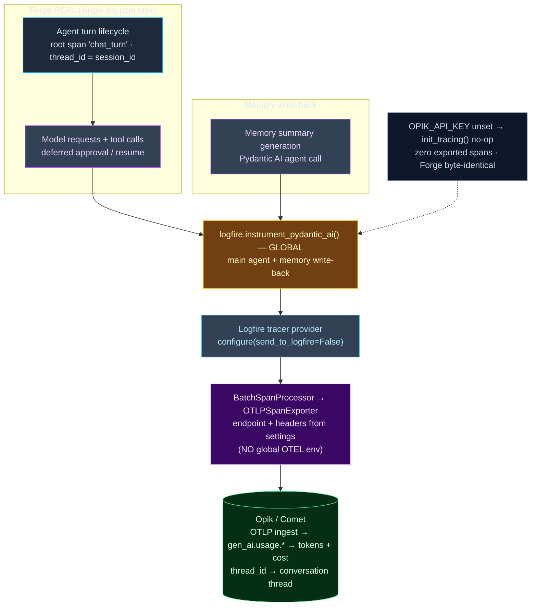

# 002. Opik observability — traces for every turn and LLM call

**Status:** Accepted

## Context

Forge has a terminal REPL running a Pydantic AI ReAct loop on Gemini, with core tools, deferred tool approvals, mid-turn steering, memory write-back, and replayable session logs. Every interaction can involve multiple model requests and tool executions. Until now, there is no centralized way to inspect what a turn actually did: which model calls happened, with what inputs/outputs, how many tokens, how much latency, and what it cost.

Milestone 2 introduces **observability** (tracing), not evaluation — evaluation, experiments, and automated scoring are separate concerns and will be addressed in a later milestone.

Constraints that shaped the design:

* **Every LLM call in the current implementation uses Pydantic AI Agents** — the main agent is constructed through `agent/factory.py` and executed through the existing harness; memory write-back also uses the agent infrastructure. A single global instrumentation call can cover these surfaces without per-call-site code.

* **House rule: infrastructure imported, not abstracted; simplest thing that works.** Prefer the sanctioned integration over hand-rolled spans; one small module, no speculative seams.

* **House rule: never read/mutate `os.environ` deep in call sites; config lives in `settings.py`.** The Opik documentation's default recipe configures export through global `OTEL_EXPORTER_OTLP_*` environment variables. However, global OpenTelemetry configuration can interfere with other infrastructure that introduces its own OTel SDK. Export must be configured programmatically from Forge settings and attached only to Logfire's tracer provider.

* **Presence-based enablement, byte-identical when off.** Like other optional infrastructure, a no-key run must be indistinguishable from the current implementation.

* **`filterwarnings=["error"]`** — new dependencies' warnings and deprecated instrumentation formats must fail the test suite.

Facts verified against the official integration documentation before deciding:

* **Official recipe** (comet.com/docs/opik/integrations/pydantic-ai): `logfire.configure(send_to_logfire=False)` + `logfire.instrument_pydantic_ai()`; thread grouping through `with logfire.span("chat_turn", thread_id=...)`; the programmatic `additional_span_processors=[...]` path supports the documented Opik integration.

* **OTLP ingest** (comet.com/docs/opik/integrations/opentelemetry): Opik reads standard `gen_ai.usage.input_tokens`, `output_tokens`, `total_tokens`, `gen_ai.request/response.model`, and `gen_ai.system` attributes. Cloud base: `https://www.comet.com/opik/api/v1/private/otel`; self-hosted base: `http://localhost:5173/api/v1/private/otel`. Headers include `Authorization`, `Comet-Workspace`, and `projectName`. The HTTP trace exporter is `opentelemetry.exporter.otlp.proto.http.trace_exporter.OTLPSpanExporter`.

* **Cost** (comet.com/docs/opik/tracing/advanced/cost_tracking): Opik estimates cost server-side using provider, model, and usage. It aggregates costs from spans within a trace. Cost is `None` for unsupported models.

* **Pydantic AI `InstrumentationSettings` defaults** (pydantic.dev/docs/ai): `include_content=True`, `include_binary_content=True`, `version=5`, and `use_aggregated_usage_attribute_names=True`. These defaults provide full content capture, avoid deprecated instrumentation formats, and prevent double-counting aggregated agent usage. No custom settings are required.

* **`logfire` dependencies:** Logfire brings the OpenTelemetry SDK and OTLP HTTP exporter transitively, allowing the complete integration with one new top-level dependency.

* **`logfire.testing`** provides `TestExporter`, `capfire`, `CaptureLogfire`, and `exported_spans_as_dict` for hermetic span assertions.

* **Turn lifecycle:** Forge's existing harness owns the complete REPL turn lifecycle, including model execution, deferred tool approval, resume, and completion. One root span must cover the complete turn rather than individual model-request legs.

### Terminology — how Pydantic AI, Logfire, OpenTelemetry, and Opik fit

The four names in this ADR are **four layers of one pipeline**, not four alternatives:

| Layer                    | What it is                                                                               | In Forge                                                                          |
| ------------------------ | ---------------------------------------------------------------------------------------- | --------------------------------------------------------------------------------- |
| **Pydantic AI**          | The LLM framework whose Agents make the calls — the thing being observed                 | Main agent and memory write-back                                                  |
| **Logfire**              | Pydantic's instrumentation SDK — a thin wrapper around OpenTelemetry                     | `instrument_pydantic_ai()`, `configure()`, `span()` in `observability/tracing.py` |
| **OpenTelemetry (OTel)** | The vendor-neutral standard + SDK for traces, metrics, and logs; the wire format is OTLP | `OTLPSpanExporter`, `BatchSpanProcessor`, and `gen_ai.*` span attributes          |
| **Opik**                 | The backend that ingests spans and calculates costs                                      | The OTLP endpoint receiving exported traces                                       |

* **OpenTelemetry** is the common language. A **span** is one unit of work (an LLM or tool call) with a name, timing, and key-value attributes; spans nest into a **trace** (one REPL turn) through asynchronous context propagation; **OTLP** is the protocol that ships them. The standardized GenAI semantic-convention attributes (`gen_ai.usage.*`, `gen_ai.request.model`, `gen_ai.system`) are what Opik reads to surface tokens and cost.

* **Logfire** is OTel underneath (`logfire.span` creates an OTel span; `configure()` configures an OTel provider). We use the **library, not Pydantic's hosted platform** — `send_to_logfire=False` borrows its instrumentation and redirects spans to Opik. It earns its place because `instrument_pydantic_ai()` is a one-call global integration rather than manually instrumenting every call site. Installing Logfire also brings the OTLP exporter and OTel SDK transitively.

* **OTLP is Opik's documented transport** for the Logfire/Pydantic AI integration — not a bypass of the Opik SDK. The narrow choice is `OTLPSpanExporter` over the Opik SDK's `OpikSpanProcessor`: both are Opik paths, but the exporter arrives with Logfire while `OpikSpanProcessor` requires the additional `opik` dependency.

## Decision

**Mechanism = the official Logfire integration, globally instrumented, exported programmatically to Opik over OTLP.**

Compared against the alternatives:

| Mechanism                                                     | What it is                                                                                                            | Coverage                                                               | New deps              | Cost / tokens                                        | Verdict                                                                                                                  |
| ------------------------------------------------------------- | --------------------------------------------------------------------------------------------------------------------- | ---------------------------------------------------------------------- | --------------------- | ---------------------------------------------------- | ------------------------------------------------------------------------------------------------------------------------ |
| **Plain OTel SDK (manual spans)**                             | Hand-instrument every LLM/tool call with raw OpenTelemetry spans and `gen_ai.*` attributes                            | Everything, but instrumentation must be written at every call site     | OTLP exporter         | Usage must be populated manually                     | Rejected — reinvents what `instrument_pydantic_ai()` provides; touches every surface; brittle                            |
| **Logfire official (CHOSEN)**                                 | `logfire.configure(send_to_logfire=False)` + global `instrument_pydantic_ai()` + settings-driven OTLP exporter → Opik | All Pydantic AI agents, including the main agent and memory write-back | **`logfire` only**    | `gen_ai.usage.*` on LLM spans → Opik calculates cost | **Chosen** — sanctioned integration; one global call; minimal dependencies                                               |
| **Opik SDK decorators (`@opik.track` / `OpikSpanProcessor`)** | Decorate execution entrypoints and/or register `OpikSpanProcessor`                                                    | Decorated entrypoints; merging requires the processor                  | `+opik` (and Logfire) | Native Opik SDK cost tracking                        | Deferred — additional dependency and per-entrypoint decoration; only justified if OTLP cost tracking proves insufficient |
| **Post-hoc reconstruction**                                   | Rebuild traces from Forge's JSONL session log                                                                         | Partial, lossy                                                         | None                  | No live latency, tokens, or cost                     | Rejected — lossy, no live signal, duplicates OpenTelemetry                                                               |

Sub-decisions (all recorded so they are not re-litigated):

1. **Enablement = presence of `OPIK_API_KEY`.** Set → tracing enabled against Opik Cloud; `OPIK_URL_OVERRIDE` switches the OTLP base to a self-hosted Opik instance; neither → `init_tracing()` is a silent no-op and Forge is byte-identical. Full message/tool content is captured (`include_content=True` default). One INFO line when active.

2. **Export is settings-driven, not env-driven.** `init_tracing()` builds `OTLPSpanExporter(endpoint="<base>/v1/traces", headers={Authorization, Comet-Workspace, projectName})` from Forge settings and attaches it through `logfire.configure(send_to_logfire=False, additional_span_processors=[BatchSpanProcessor(exporter)])`. No global `OTEL_*` environment variable is set.

3. **Instrumentation is global and default-configured.** `logfire.instrument_pydantic_ai()` with no custom `InstrumentationSettings` — the defaults provide full content, format v5, and `use_aggregated_usage_attribute_names=True` so Opik prices leaf LLM spans without double-counting the aggregating agent-run span. One call covers the main agent and memory write-back.

4. **Trace shape.**

   * **REPL:** One trace per turn — a root span (`chat_turn`, `thread_id` = Forge session ID) wraps the complete agent-turn lifecycle. Model-request legs, tool calls, and deferred approval/resume operations remain within the same trace through shared asynchronous task context. The root span must remain active across yields and close deterministically on normal completion, error, and abort.

   * **Memory write-back:** Memory summary generation uses the same global instrumentation. When executed outside an active turn, it produces its own trace.

   * **Future surfaces:** Any future Pydantic AI call sites, including subagents and compaction, automatically receive instrumentation through the same global integration. Their trace nesting depends on context propagation.

   * **Root-span input/output:** The manually opened `chat_turn` root starts without input/output. Pydantic AI's own spans capture their I/O through global instrumentation, but Opik derives a trace's input/output from its root span. Therefore, the root must explicitly carry the user's prompt as an `input` attribute and, at turn completion, the final assistant response as an `output` attribute through `observability.record_output(span, ...)`. Opik's OTLP ingest maps attributes using input/output prefixes. This is important for **Threads**: without root-level input/output, conversations may display empty rows even though nested LLM spans contain their own I/O.

5. **Init seam = `observability.init_tracing()`.** Idempotent (Logfire configuration is process-global), called from the Forge application entrypoint before agent execution. One small module (`observability/tracing.py`) holds `init_tracing`, `is_tracing_active`, `root_span`, `record_output`, and `reset_tracing`.

6. **Dependencies = `logfire` only.** It brings `opentelemetry-exporter-otlp-proto-http` and `opentelemetry-sdk` transitively. Not `logfire[httpx]`, not `opik`. Watch: Logfire's OTel/protobuf dependencies must co-resolve with Forge's existing dependency tree.

7. **Test isolation.** An autouse `_no_opik_tracing` fixture blanks `opik_api_key` so ordinary tests never configure real export. Span-asserting tests opt in with a fake key and `logfire.testing`'s in-memory exporter; `reset_tracing()` clears module state.

8. **Cost path.** Tokens are provided through `gen_ai.usage.*` on LLM spans. Cost is Opik's server-side estimate for priced models; unsupported models may expose token usage without cost. **Escape hatch:** if the OTLP path proves to omit cost for Forge's configured models, swapping to the Opik SDK's `OpikSpanProcessor` is a small change in `tracing.py` — the sanctioned "only if necessary" trigger.

9. **Future evaluation milestone.** Evaluation datasets, experiments, automated scoring, and online evaluation will build on top of these traces in a separate milestone. They are not part of this ADR.

## Diagram

**Span flow** — Forge REPL turns and memory write-back feed one global instrumentation, exported from settings to Opik.

## Consequences

* **One global call covers every Pydantic AI surface.** Adding a future Pydantic AI LLM call site is traced without per-site instrumentation.

* **Forge is byte-identical without `OPIK_API_KEY`.** The feature is inert until a key is set; the REPL prints no additional line and zero telemetry spans are exported.

* **Configuration stays in `settings.py`.** No global `OTEL_*` environment variable is mutated, keeping telemetry configuration isolated from other infrastructure.

* **Cost is best-effort by model.** Token usage is available through GenAI semantic conventions; cost is calculated for models with supported pricing. The Opik SDK escape hatch is available if required.

* **One root trace represents one REPL turn.** Deferred approval and resume operations remain part of the same turn, and the root span includes the complete execution lifecycle.

* **Memory write-back uses the same instrumentation.** No separate model-call instrumentation is required.

* **Evaluation remains outside this milestone.** The traces establish the foundation for future evaluation and experiment workflows without introducing them now.

* **Risks to confirm during implementation:** (a) `uv add logfire` co-resolving its OTel/protobuf dependencies with Forge's existing packages; (b) the root span remaining active across asynchronous generator `yield` operations and closing exactly once on abort; (c) root input/output appearing correctly in Opik Threads; (d) Gemini token usage and cost materializing through pure OTLP; (e) `logfire.configure` coexisting with any other OpenTelemetry provider introduced by infrastructure.

* **Discipline (unchanged):** `filterwarnings=["error"]`, UTC-aware datetimes, full annotations, library code logs (never `print()`), `tests/` mirror `src/` 1:1, TDD-first, no network in CI (`FunctionModel` + `logfire.testing`; one live smoke test guarded by `skipif`).
