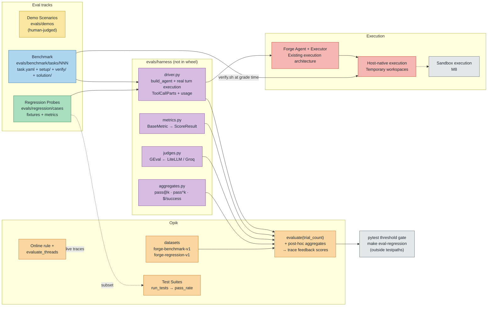

# 003. Forge Evaluation Suite — Demos, Benchmark, Regression Probes, Opik Harness

**Status:** Accepted

## Context

Forge has tracing (ADR-002) but no way to answer "did this change make the agent better or worse?".

We want: (a) human-judged showcase demos, (b) an outcome benchmark ("can it do the task?"), (c) a harness-behavior regression suite ("does it work the RIGHT way?" — right tool, minimal diff, permission gate respected), and (d) the Opik evaluation infrastructure driving (b) and (c) — in an educational codebase where grading logic must stay readable and infrastructure is imported, not abstracted.

Constraints:

* `tests/` mirrors `src/forge/` 1:1 where applicable.
* The wheel ships only `src/forge`.
* Existing Opik tracing (ADR-002) must not be disturbed.
* `make ci` must stay eval-free (evaluations need API keys and cost money).
* Evaluation must exercise Forge's actual agent implementation, not a separate agent.
* The current Gemini-based agent configuration remains unchanged.
* Groq is used for LLM-as-a-Judge, independently of the production agent provider.
* The existing executor architecture must be reused; dedicated sandbox infrastructure belongs to M8.

Non-goals: Terminal-Bench/SWE-bench adapters, leaderboard UI, credential-proxy involvement, best@k/majority-vote, user simulation.

## Decision

1. **Placement: top-level `evals/`, not `src/forge/evals/`.**

   Eval code is course material about the agent, not part of it — the existing wheel configuration ships only `src/forge`, so the wheel is untouched with zero additional build configuration.

   Unit tests for harness code live in `tests/unit/evals/` (following the existing test organization):

   ONE pytest root means `make unit-tests`, pre-commit hooks, and CI cover the harness's offline logic for free.

   The one deliberate exception is `evals/regression/test_thresholds.py` — a key-requiring, money-costing module kept OUTSIDE `testpaths` and invoked only by `make eval-regression`.

2. **Four tracks, three judgment styles.**

   Demo scenarios (human-judged, no Opik, under `evals/demos/`); a 20-task Benchmark (outcome oracles); a 15-probe Regression suite (behavior metrics + a few judges); the Opik harness underneath.

   Demos prove it impresses; the benchmark proves it works; the probes prove it works the way we designed (ADR-001 and ADR-002 behaviors: tool selection, permission enforcement, deferred execution, steering, session persistence, and observability).

3. **Execution reuses Forge's existing executor seam — no new runner infrastructure.**

   Benchmark runs get a fresh per-task Workspace through Forge's existing agent and tool execution architecture, using the executor interface rather than introducing a separate evaluation runner.

   Regression probes run host-native (`none` mode) on temporary directories — fast enough for a per-feature-branch ritual.

   The least-mechanism choice: reuse the existing execution architecture now and introduce sandbox-backed isolation when the corresponding milestone is implemented.

4. **In-process agent driving; tool calls from messages, never from traces.**

   One driver (`evals/harness/driver.py`) runs the REAL Forge implementation using `build_agent()` + the existing agent dependencies + the actual turn execution and deferred-request/resume lifecycle.

   The driver must exercise the existing permission gate, tool registry, and execution mechanisms rather than bypassing them.

   Tool calls are extracted from Pydantic AI `ToolCallPart`s in message history and usage from summed `ModelResponse.usage` — parsing Opik traces for ground truth would couple grading to the observability pipeline and introduce sampling/export-lag issues.

   Opik `evaluate()` task functions are synchronous, so the driver ships an `asyncio.run()` wrapper.

5. **Verify oracles are hidden but honest.**

   `verify/` assets are injected through the execution seam only AFTER the agent finishes (the agent can never inspect its own grader).

   `verify.sh` IS the grading logic — a readable Bash script, Terminal-Bench-style.

   Every task commits a `solution/` and the oracle-sanity pytest harness proves each oracle BOTH directions (solution → PASS, untouched → FAIL) in ordinary CI, so a broken oracle can't silently grade everything up or down.

6. **Two regression surfaces, deliberately.**

   **(a) Plain datasets + code metrics via `evaluate()`**

   Uses a pytest threshold gate:

   * `aggregate_evaluation_scores()` ≥ configured thresholds.
   * Baseline deltas via `get_experiments_by_name` as warnings.

   **(b) Opik 2.0 Test Suites**

   Uses `get_or_create_test_suite`, natural-language assertions, and `run_tests` → `pass_rate` over a small probe subset.

   Redundant on purpose: the contrast between deterministic metrics and natural-language assertions is the teaching point.

7. **Judge routing uses Groq through LiteLLM.**

   One judge factory builds `GEval(model=<LiteLLM model>)`.

   Default judge:

   `groq/openai/gpt-oss-120b`

   Lightweight alternative:

   `groq/openai/gpt-oss-20b`

   `EVAL_JUDGE_MODEL` overrides the default.

   `GROQ_API_KEY` authenticates judge requests.

   Judges are reserved for what code can't score (quality, groundedness, minimal-diff on tasks 15/19/20 and judge probes); everything mechanical stays a `BaseMetric` → `ScoreResult`.

   Judge routing remains independent of Forge's production agent provider. The current Gemini agent configuration is not changed.

8. **Trials + aggregation on Opik's own axis.**

   `--trials k` → `evaluate(trial_count=k)`.

   pass@1 / pass@k / pass^k / flakiness-rate and cost-normalized success-per-dollar are computed as post-hoc pure functions over the `evaluate()` result's `test_results`.

   These aggregates are attached to the experiment as per-item trace feedback-scores, whose per-experiment averaging surfaces them on the experiment row.

   `experiment_config` records agent model, provider, git SHA, judge model, and evaluation configuration.

   Costs come from recorded usage (+ Opik trace `total_cost` where available).

   Judge-model costs must also be accounted for separately when calculating evaluation cost.

9. **Cadence: manual, never in `make ci`.**

   `make eval-benchmark` / `make eval-regression` require:

   * `GEMINI_API_KEY`
   * `GROQ_API_KEY`
   * `OPIK_API_KEY`

   The regression ritual is pre-merge per feature branch and the threshold module is CI-pointable later.

   Eval runs log under `EVAL_PROJECT_NAME` (`forge-evals`), so live-REPL tracing (ADR-002, project `forge`/`forge-<env>`) is never polluted — the harness must not fight `init_tracing()`.

   Evaluation-specific experiment tracking must remain separate from the existing Logfire/OpenTelemetry tracing configuration.

10. **Online eval stays small.**

    One documented Opik online LLM-judge rule + one scripted thread-level `evaluate_threads` pass over the LIVE project's threads.

    The online rule automatically evaluates newly ingested production traces according to its configured criteria.

    The scripted `evaluate_threads` pass separately evaluates existing conversation threads.

    Both use traces generated by ADR-002. No separate production tracing implementation is introduced.

    The initial online evaluator demonstrates one meaningful quality check, such as whether Forge's final response accurately reflects the operations performed and results returned by its tools.

## Diagram

## Consequences

* **Positive:** Regressions in agent BEHAVIOR (not just outcomes) become measurable per feature branch; grading stays transparent (verify.sh + readable metrics); existing executor architecture is reused; the wheel, `make ci`, and live tracing are all untouched; oracle-sanity keeps 20 hand-written graders honest.

* **Negative / accepted:** Eval runs cost real money and need keys — hence manual cadence, which means the suite only catches what someone runs; LLM judges are noisy (mitigated: judges only where code can't decide, thresholds not exact-match, pass^k for reliability); k-trial runs multiply cost linearly; two regression surfaces mean some duplication (accepted for the contrast); `evals/` grows a second source root that tests must mirror by convention, enforced only by review.

* **Deferred / upgrade paths:**

  * Pointing CI at the threshold module.
  * sandbox-backed benchmark execution.
  * Probe 12 (MCP) activates when Forge's MCP tool factory ships.
  * Terminal-Bench/SWE-bench adapters only if the in-house 20 stop discriminating between agent versions.
  * Additional online evaluators as Forge's real-world usage grows.
